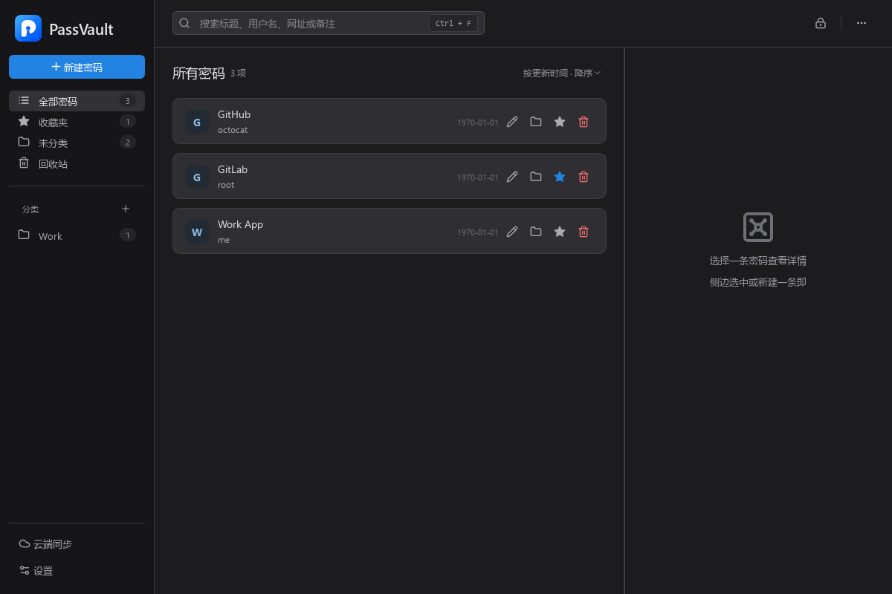

# PassVault

[](LICENSE)
[](#开始使用)
[](#从源码构建)

一款本地优先的 Windows 桌面密码管理器，使用 C++17 和 Qt 6 Widgets 开发。离线管理密码，也可通过 Google Drive 同步加密备份，与 PassVault Android 端交换数据。



*截图由隔离的内存数据库生成，全部条目均为虚构测试数据。*

## 功能

- **密码管理**：保存账号、密码、网站和备注，支持分类、收藏、搜索与排序。
- **回收站**：恢复误删条目，或永久删除不再需要的数据。
- **密码生成**：生成 8–32 位密码，自定义字符组合，查看强度提示；可在侧边栏或按 `Ctrl+G` 打开独立生成器，无需新建条目。
- **批量迁移**：CSV 导入前预览新增、更新与无效行，支持导出。
- **可选同步**：通过 Google Drive 上传加密备份，合并多端条目。
- **日常保护**：自动锁定、剪贴板定时清理，以及主密码修改。
- **主题切换**：浅色、深色或跟随系统。

## 开始使用

支持 Windows 10 及以上版本（x64）。

在 [Releases](https://github.com/leishufei/PassVault_windows/releases) 下载发布包；若尚无发布版本，可在 [Windows 工作流](https://github.com/leishufei/PassVault_windows/actions/workflows/windows.yml) 的成功运行中下载 `PassVault-windows-x64` 产物。解压全部文件后运行 `PassVault.exe`，无需安装 Qt 或编译工具。

公开构建不内置 Google OAuth 凭据，适合离线使用；云同步需要按下方说明自行配置并构建。

1. 首次启动时设置主密码，建议使用较长且独立的密码。
2. 添加密码条目，或通过设置中的 CSV 导入迁移已有数据。
3. 如需云同步，在设置中连接 Google 账户；自行构建时需先配置下方的 OAuth 凭据。

本地数据保存在 `%APPDATA%\PassVault`，离线使用无需 Google 账户。请妥善保管主密码。

## 从源码构建

### 环境

- Windows 10+（x64）
- Qt 6.5+ 的 MinGW 64 位套件，包含 Core、Gui、Widgets、Network、Svg 和 Test
- 与 Qt 套件匹配的 MinGW-w64
- [CMake 3.25+](https://cmake.org/cmake/help/v3.25/manual/cmake-presets.7.html)（仓库使用版本 6 的 preset 格式）、Ninja 和 Git
- 已初始化的 vcpkg；OpenSSL 和 GoogleTest 由 manifest 自动安装

SQLite 源码已包含在仓库中。当前提供 MinGW 构建预设。

### 构建与运行

在 PowerShell 中执行，Qt、MinGW 和 vcpkg 路径请替换为本机安装位置；CMake 和 Ninja 需在 `PATH` 中：

```powershell
git clone https://github.com/leishufei/PassVault_windows.git
cd PassVault_windows

$env:QT_ROOT = 'C:\Qt\6.8.3\mingw_64'
$env:MINGW_ROOT = 'C:\Qt\Tools\mingw1310_64'
$env:VCPKG_ROOT = 'C:\vcpkg'
$env:PATH = "$env:MINGW_ROOT\bin;$env:QT_ROOT\bin;$env:PATH"

cmake --preset mingw-x64-release
cmake --build --preset mingw-x64-release --parallel
.\build\mingw-x64-release\PassVault.exe
```

首次配置会下载并编译依赖。构建会在找到 `windeployqt` 时自动部署 Qt 运行库；分发程序时需携带部署后的 DLL、插件和相关许可证，不能只复制 EXE。

调试构建可将预设替换为 `mingw-x64-debug`。本机配置也可写入未跟踪的 `CMakeUserPresets.json`。

### 运行测试

```powershell
ctest --preset mingw-x64-release
```

测试使用 GoogleTest 与 Qt Test。只运行特定用例时：

```powershell
.\build\mingw-x64-release\passvault_tests.exe --gtest_filter='*CryptoService*'
```

### 打包

使用空的 OAuth 配置构建 Release 后，执行：

```powershell
cmake --preset mingw-x64-release -DGOOGLE_DESKTOP_CLIENT_ID= -DGOOGLE_DESKTOP_CLIENT_SECRET=
cmake --build --preset mingw-x64-release --target passvault --parallel
.\scripts\package-release.ps1
```

脚本从程序及运行依赖生成 `build/packages/<时间戳>/PassVault-windows-x64.zip` 和 SHA-256 校验文件，不复制本地数据目录。打包时需联网获取标准 Qt 许可证文本。

Windows CI 会在推送 `main`、提交 PR 或手动触发时执行构建、测试和打包，通过后上传压缩包与测试结果。

### Google Drive 同步（可选）

在 Google Cloud 项目中[启用 Google Drive API](https://developers.google.com/workspace/guides/enable-apis)，并创建“桌面应用”类型的 OAuth 客户端。根据项目的 OAuth 发布状态配置测试用户或完成所需配置。

在首次运行 CMake 配置前，通过环境变量提供 `GOOGLE_DESKTOP_CLIENT_ID` 和 `GOOGLE_DESKTOP_CLIENT_SECRET`，或在本机的 CMake 缓存中设置同名变量，然后重新配置、构建。无需同步时可留空，本地功能仍可使用。

授权通过浏览器完成，采用 PKCE 和本机回调，仅申请 `drive.file` 权限。加密备份位于 Google Drive 的 `PassVault/PassVault_Cloud_Backup.json`。凭据、本机 CMake 缓存和生成的配置头文件不要提交到仓库。

## 数据与安全

- 条目的**密码字段**使用 AES-256-GCM 加密后存入 SQLite；标题、用户名、网站、备注等本地元数据以明文保存。
- 会话密钥使用 PBKDF2-HMAC-SHA256 派生，迭代 600,000 次；云端备份整体加密后上传。
- 本地主密码校验值为 SHA-256，记录由 Windows DPAPI 保护；Google 刷新令牌同样由 DPAPI 保护。这些本地记录与 Windows 用户环境绑定。
- CSV 导出包含明文密码，请妥善保存并及时清理。
- 本仓库不包含独立安全审计报告，使用重要数据前请自行评估并做好备份。

## 反馈与贡献

欢迎通过 [Issues](https://github.com/leishufei/PassVault_windows/issues) 报告问题或提出建议，提交时请附 Windows 版本、构建方式和复现步骤，避免包含真实密码、保险库文件或授权凭据。

提交代码前请运行相关测试，C++ 代码遵循仓库的 `.clang-format`。涉及加密或同步格式的修改需要保持 Android 端兼容。

## 许可证

项目代码采用 [MIT](LICENSE) 许可证。第三方组件遵循各自许可证，随仓库分发的字体许可见 `resources/fonts/LICENSE-*.txt`。
